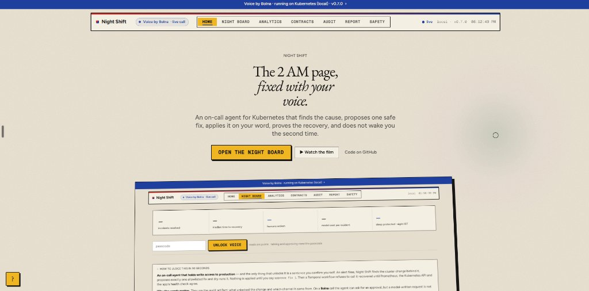
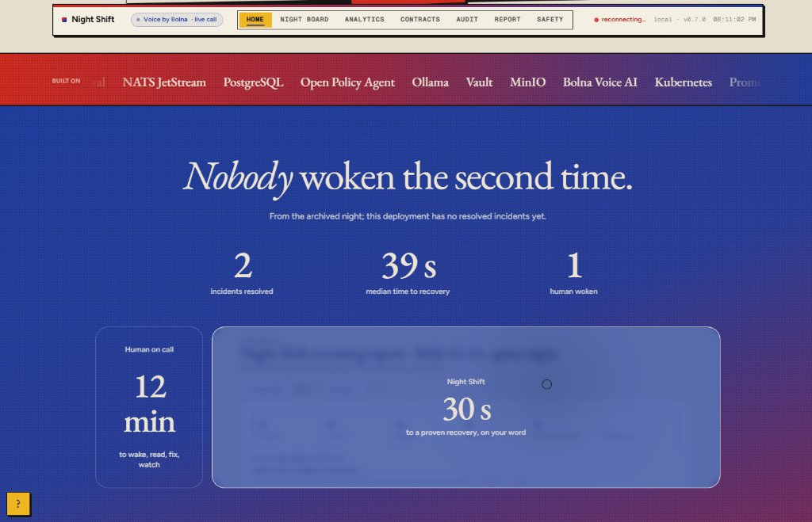
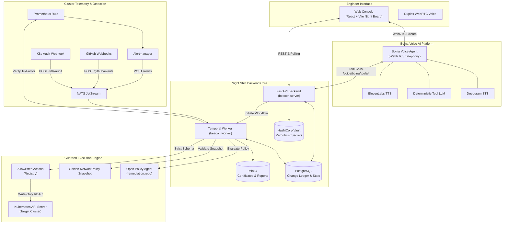
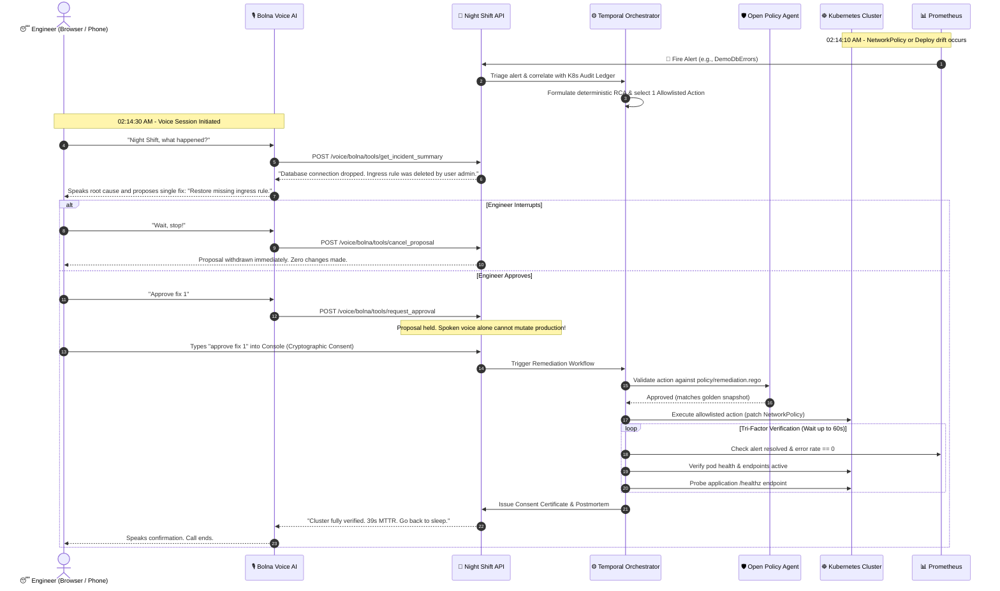
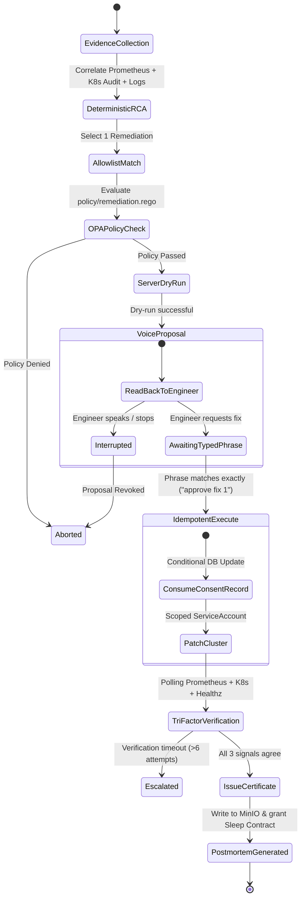

# Night Shift

<p align="center">
  
</p>

> ### 🌙 The 2 AM page, fixed with your voice.
> **Night Shift is a voice assistant for engineers on call.**  
> When a system breaks at 2 AM, you talk to it through Bolna voice AI. It explains what went wrong, suggests one safe fix, and waits for your clear approval before touching anything. Then it applies the fix, checks that everything truly recovered, and writes the report. **Interrupt it and it stops.**

<p align="center">
  
</p>

---

## 💡 Why Night Shift?

At 2:00 AM, sleep inertia degrades cognitive function by up to 50%. Reading through hundreds of lines of stack traces, correlating Prometheus alerts, and running high-privilege `kubectl` commands in production while half-asleep causes outages to escalate.

**Night Shift turns incident triage into a calm, guided voice conversation:**

1. **You wake up and talk.** Connect directly from your browser or phone via real-time duplex voice powered by Bolna Voice AI.
2. **Deterministic triage first.** Night Shift correlates Prometheus alerts, Kubernetes audit events, Loki logs, and cluster change ledgers.
3. **One safe fix proposed.** It never hallucinates or generates freeform shell scripts. It selects exactly one allowlisted remediation, validates it against Open Policy Agent (OPA), and runs a server-side dry run.
4. **Strict human consent.** The agent reads back the exact action and blast radius. It requires an unequivocal approval (`approve fix 1`). A spoken sentence queues the intent; a typed confirmation seals the cryptographic consent certificate.
5. **Interrupt to abort.** Any voice interruption ("stop", "wait", "hold on") immediately halts execution and revokes the proposal.
6. **Tri-factor recovery verification.** Night Shift refuses to mark an incident resolved until Prometheus, the Kubernetes API, and the service health check all independently confirm recovery.
7. **Sleep Contracts.** "Nobody woken the second time." The agent issues postmortems and grants temporary Sleep Contracts so identical recurring pages are remediated safely without waking you up again.

---

## 🏛️ System Architecture

Night Shift runs entirely on Kubernetes with zero proprietary cloud lock-in.



### Core Architecture Components

| Domain | Technology | Purpose |
|---|---|---|
| **Voice Interface** | **Bolna Voice AI** | Full-duplex WebRTC streaming, custom tool function calling, low-latency STT/TTS, and live interruption detection. |
| **API & Ingestion** | **FastAPI** (`beacon.server`) | Ingestion of Prometheus alerts, Kubernetes audit logs, Bolna webhooks, and REST console endpoints. |
| **Execution Engine** | **Temporal** + Python Worker | Durable, retryable remediation workflows that guarantee idempotent execution and multi-stage verification. |
| **Policy & Safety** | **Open Policy Agent (OPA)** | Evaluates `policy/remediation.rego` before dry runs and executions. Zero approval from OPA = zero cluster mutation. |
| **Event Bus & Storage** | **NATS JetStream** + **PostgreSQL** | High-throughput event delivery and persistent ledger tracking cluster changes and historical approvals. |
| **Audit & Storage** | **MinIO S3** | Durable cold storage for signed consent certificates, execution transcripts, and incident postmortem reports. |
| **Security & Secrets** | **HashiCorp Vault** + **K8s RBAC** | Segregation of duties: API service account is strictly read-only; worker service account is scoped strictly to remediable resources. |
| **Frontend Console** | **React 18 + Vite + Tailwind** | "Night Board" real-time incident HUD, audio telemetry, live duplex calling, and manual confirmation gateway. |

---

## ⚡ 2 AM Incident Lifecycle

Here is how an incident unfolds from the moment a pod crashes to the signed recovery certificate:



---

## 🔒 Safety Architecture & State Machine

Night Shift adheres to a strict zero-trust execution model. No autonomous action can touch production without traversing the state machine below:



### Safety Tenets

1. **Strict Action Allowlist**: Only 4 allowlisted actions exist (`src/beacon/remediation/registry.py`):
   - `networkpolicy.restore_ingress`
   - `networkpolicy.revoke_ingress`
   - `deployment.restart`
   - `deployment.rollback`
   Parameters must conform to rigid JSON schemas. **No model output is ever executed in a shell.**
2. **Golden Snapshot Protection**: NetworkPolicy rules can only be restored if they match an immutable golden snapshot recorded during cluster commissioning (`make snapshot`).
3. **Dual Identity RBAC**: The user-facing API runs under a Kubernetes ServiceAccount with strictly read-only permissions. Only the backend worker has write access, scoped strictly to allowlisted namespaces (`REMEDIABLE_NAMESPACES`).
4. **Barge-In Interruption Guarantee**: Audio levels and speech barge-in are continuously evaluated. The moment the on-call engineer interrupts the agent, all pending proposals are withdrawn instantly.
5. **Sleep Contracts**: After resolving an incident, the engineer can grant a time-bound, use-bounded "Sleep Contract" (e.g. valid for 7 days or 2 occurrences). If the identical root cause repeats within the window, Night Shift remediates it automatically without waking the human.

---

## 🚀 Getting Started

### Prerequisites

- **Docker** & **k3d** (or existing Kubernetes 1.28+ cluster)
- **kubectl**
- **Python 3.12+** & **uv** (`curl -LsSf https://astral.sh/uv/install.sh | sh`)
- **Node.js 20+** & **npm**
- **Bolna Account**: API key from [platform.bolna.ai](https://platform.bolna.ai)

---

### Local Installation

#### 1. Clone the repository
```bash
git clone https://github.com/victrvondoom/Night-Shift.git
cd Night-Shift
```

#### 2. Configure Environment
```bash
cp .env.example .env
```
Edit `.env` to configure your tokens and secrets:
```env
PASSCODE=nightshift-secret
BOLNA_API_KEY=your_bolna_api_key
BOLNA_PUBLIC_URL=https://your-domain-or-tunnel.ngrok.app
```

#### 3. Install Dependencies & Build
```bash
make setup
```

#### 4. Spin Up the Local Kubernetes Cluster
```bash
make cluster
```
*Creates a dedicated k3d cluster with API server audit logging enabled.*

#### 5. Deploy Night Shift Infrastructure
```bash
make up
```
*Builds local container images, initializes Vault, deploys PostgreSQL, NATS, OPA, MinIO, and sets up the golden NetworkPolicy snapshot.*

---

## 🎙️ Bolna Voice AI Setup

1. **Sign up at [platform.bolna.ai](https://platform.bolna.ai)** and copy your API Key into `.env` (`BOLNA_API_KEY`).
2. **Configure Voice Providers** in Bolna Settings:
   - Speech-to-Text: Deepgram
   - LLM: OpenAI (`gpt-4o-mini`)
   - Text-to-Speech: ElevenLabs
3. **Expose your local endpoint** via tunnel (Cloudflare Tunnel or ngrok) to port `30080`:
   ```bash
   ngrok http 30080
   ```
   Set `BOLNA_PUBLIC_URL=https://<your-subdomain>.ngrok.app` in `.env`.
4. **Register the Voice Agent with Bolna**:
   ```bash
   make bolna-agent
   ```
   *Registers all 9 custom diagnostic and consent tools pointing to `/voice/bolna/tools/<tool_name>`.*
5. Copy the generated `BOLNA_AGENT_ID` into your `.env` and run `make up`.

---

## 🧪 Interactive Live Demos

Night Shift includes two reproducible real-world Kubernetes failure scenarios:

### Demo 1: NetworkPolicy Drift (Broken Ingress)
Simulates an errant commit or engineer mistakenly stripping database ingress rules:
```bash
make break-netpol
```
- **What happens:** The demo web service loses access to PostgreSQL.
- **The alert:** `DemoDbErrors` fires within 20 seconds.
- **The resolution:** Connect over voice in the console. Night Shift isolates the missing rule against the golden snapshot, requests confirmation, and restores database ingress.

### Demo 2: Bad Deployment Rollout (CrashLoopBackOff)
Simulates a poisoned container image rollout that crashes on startup:
```bash
make bad-deploy
```
- **What happens:** Deployments exit with non-zero exit codes.
- **The alert:** `DemoApiDown` fires.
- **The resolution:** Night Shift analyzes the replica failure, dry-runs a deployment rollback to the previous revision, and applies it upon your spoken & typed approval.

### Automated End-to-End Test Suite
Run the full automated E2E test covering both scenarios and RBAC boundaries:
```bash
make e2e
```

---

## 💻 Frontend Console (Night Board)

To run the web console independently for development:
```bash
cd web
npm install
npm run dev -- --host 127.0.0.1 --port 5173
```
- **Live Console UI:** [http://localhost:5173](http://localhost:5173)
- **Production Console (via Caddy/K8s):** [http://localhost:30080](http://localhost:30080)
- **Grafana Dashboard:** [http://localhost:30300](http://localhost:30300)

---

## 📂 Repository Layout

```
├── src/beacon/              # Core Python backend package
│   ├── server.py            # FastAPI endpoints (Alerts, Bolna tools, Webhooks, REST)
│   ├── worker.py            # Temporal workflow activities & workers
│   ├── bolna/               # Bolna Voice AI SDK & custom agent definitions
│   ├── remediation/         # Strict action allowlist & dry-run runners
│   ├── triage/              # Prometheus alert & Loki log correlation engines
│   └── store/               # PostgreSQL ledgers & MinIO object storage
├── web/                     # React + Vite web console ("Night Board")
│   ├── src/components/      # Duplex voice visualizer, Night Board HUD, Audit view
│   └── src/voice/           # Bolna Web Call SDK integration & audio monitor
├── policy/                  # Open Policy Agent (remediation.rego)
├── deploy/                  # Production & local k3d Kubernetes manifests
│   ├── k8s/                 # Platform services, RBAC, Vault, MinIO manifests
│   └── k3s/                 # k3d cluster config & K8s audit policy
├── demo/                    # Fault injection scripts & demo application
├── docs/                    # Architectural specs, safety documentation, runbooks
│   └── assets/              # Diagrams, screenshots, and visual assets
└── tests/                   # Comprehensive unit and integration test suites
```

---

## 🛡️ License

Distributed under the **MIT License**. See `LICENSE` for details.
